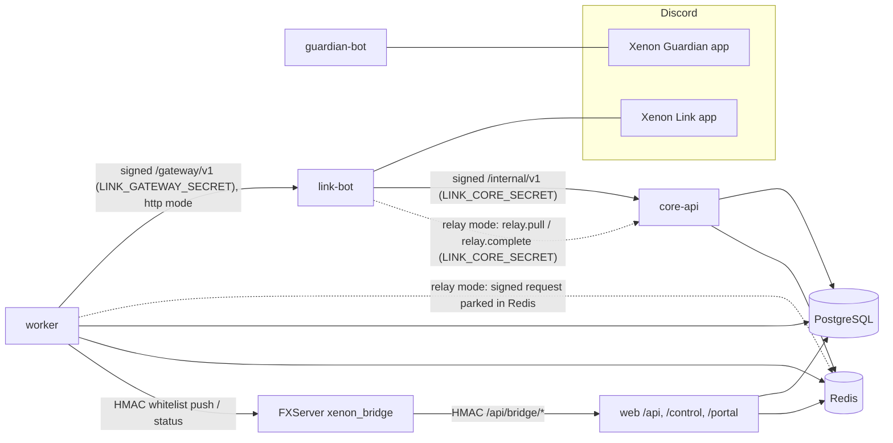

# Two Discord applications: Xenon Guardian and Xenon Link

XenonRP runs two separate Discord applications, each with its own token,
command registry, process, health check, logs and deployment:

| Application        | Purpose                                                            | Holds                                              | Never holds                                          |
| ------------------ | ------------------------------------------------------------------ | -------------------------------------------------- | ---------------------------------------------------- |
| **Xenon Guardian** | Security, moderation, onboarding, tickets, announcements           | Guardian bot token; `.data/discord-runtime.json`   | Database, Redis, Core API, FiveM or Link credentials |
| **Xenon Link**     | Website/FiveM identity, whitelist, role sync, status, staff review | Link bot token; Core API + gateway service secrets | Database or Redis credentials; Guardian token        |



Guardian has no edge to anything except Discord. Link has no edge to the
database. Neither bot depends on the other.

## Feature assignment

| Guardian (unchanged behaviour)                                   | Link                                                        | Core API / worker                                   |
| ---------------------------------------------------------------- | ----------------------------------------------------------- | --------------------------------------------------- |
| Anti-nuke, anti-raid, anti-spam, link guard, AutoMod reconcile   | Discord ↔ Xenon account (`/profile`, `/whitelist`)          | Identity, linked accounts, whitelist decisions      |
| Unauthorized role/channel change detection, lockdown, quarantine | Cfx.re link status (`/link` points to website linking)      | Application review decisions + staff audit          |
| Incident logging, snapshots, recovery journals                   | Whitelist status & application status                       | Transactional outbox + integration events           |
| Welcome messages and onboarding                                  | Staff review cards (approve / reject / changes / interview) | Role-sync planning, review-card rendering, DMs      |
| Community roles / temp voice rooms                               | Role synchronization (`/sync`)                              | Status polling, expiry and cleanup sweeps           |
| Support tickets + transcripts                                    | Live status & presence (`/status`)                          | Cross-platform moderation cases (`ModerationCase`)  |
| Announcements (`/announce`)                                      | Event notices (restarts, server up/down, staff log)         | FiveM admission decisions (`/api/bridge/whitelist`) |
| Moderation (`/warn` … `/cases`), `/security`, `/xenon`           | `/player`, `/queue`, `/review`                              | Website APIs (`/api/v1/*`)                          |

## Commands

Ownership is enforced by `@xenon/contracts` (`assertCommandOwnership`) before
either bot registers commands; a name owned by the other application fails the
deploy instead of producing two `/status` entries.

| Guardian                                                                                                                        | Link                                                                              |
| ------------------------------------------------------------------------------------------------------------------------------- | --------------------------------------------------------------------------------- |
| `/xenon` (setup, panel, automod, welcome, tickets, **status**), `/room`, `/announce`                                            | `/link`, `/profile [member]`, `/whitelist`, `/application [reference]`, `/status` |
| `/security`, `/warn`, `/warnings`, `/timeout`, `/untimeout`, `/kick`, `/ban`, `/unban`, `/softban`, `/purge`, `/case`, `/cases` | `/player <reference>`, `/review <reference>`, `/queue`, `/sync [member]`          |

Compatibility notes:

- Guardian's old `/status` (gateway/guild health) is now `/xenon status`;
  `/status` belongs to Link and shows the city.
- Guardian's placeholder `/profile`, `/application`, `/review`, `/link`,
  `/queue`, `/player` (which only answered "platform not enabled") are removed;
  Link provides the working versions.
- `/link` shows the caller's Cfx.re link and sends unlinked players to the
  website's **Connect Cfx.re** flow ([CFX_LINKING.md](CFX_LINKING.md)). Link
  never creates, changes or removes a link; the code-based `/link code:` path
  is retired.

## Discord Developer Portal

### Xenon Guardian — the existing application

Keep the existing application and token. Nothing about its configuration
changes. Intents and permissions are documented in
[DISCORD_SETUP.md §3](DISCORD_SETUP.md#3-install-the-existing-bot): Server
Members and Message Content privileged intents; no Administrator.

Invite (only if re-inviting) with scopes `bot applications.commands` and
permissions integer `1477757234358` (View Audit Log, Manage Channels, Manage
Roles, View Channels, Send Messages, Send Messages in Threads, Create
Public/Private Threads, Embed Links, Attach Files, Read Message History,
Connect, Speak, Move Members, Manage Messages, Moderate Members, Kick, Ban,
Manage Server):

```
https://discord.com/oauth2/authorize?client_id=<GUARDIAN_APP_ID>&scope=bot%20applications.commands&permissions=1477757234358
```

### Xenon Link — a new application

1. Developer Portal → **New Application** → name it `Xenon Link`.
2. **Bot**: create the bot user, copy its token into `LINK_DISCORD_TOKEN`
   (never into any Guardian env file). Leave **all** privileged gateway intents
   (Presence, Server Members, Message Content) **disabled** — Link uses only
   the `Guilds` intent and REST lookups.
3. **Installation**: guild install, scopes `bot` + `applications.commands`.
4. Invite with permissions integer `268520448` (View Channels, Send Messages,
   Embed Links, Read Message History, Manage Roles):

   ```
   https://discord.com/oauth2/authorize?client_id=<LINK_APP_ID>&scope=bot%20applications.commands&permissions=268520448
   ```

5. **Role hierarchy**: drag the `Xenon Link` role **above** every role it
   synchronizes (Whitelisted, department roles) and **below** every staff,
   moderator and admin role, and below the `Xenon Guardian` role. Link refuses
   to add/remove any role carrying Administrator, Manage Server/Roles/Channels/
   Webhooks/Messages/Threads/Nicknames/Events/Expressions, Kick, Ban, Moderate,
   Mention Everyone, View Audit Log, Move/Mute/Deafen Members, `@everyone`, or
   integration-managed roles — even if a role mapping points at one.
6. **Channel overrides**: allow Link to post in the application-review channel,
   the announcements channel (website-scheduled announcements), and the optional
   `LINK_EVENTS_CHANNEL_ID` / `LINK_STAFF_LOG_CHANNEL_ID` channels. Deny it
   elsewhere if you want posting to be strictly scoped.

> Behaviour change: role mappings that point at a Discord role with moderation
> or administrative permissions are no longer synchronized (the mapping records
> `Role carries privileged permissions; Link will not manage it`). Grant staff
> Discord roles by hand or through Guardian; Xenon capabilities never depend on
> Discord roles anyway.

### Website sign-in (OAuth)

Unchanged. Discord OAuth keeps using the current application
(`AUTH_DISCORD_ID`), so existing accounts, logins and database-backed sessions
are unaffected. Moving OAuth to the Link application later is optional: Discord
user IDs are identical across applications, so it only requires registering
`https://<domain>/api/auth/callback/discord` on the Link app and swapping
`AUTH_DISCORD_ID`/`AUTH_DISCORD_SECRET`/`DISCORD_APPLICATION_ID` in `web.env`.

## Service secrets

| Secret                   | Generated with         | Present in                                   |
| ------------------------ | ---------------------- | -------------------------------------------- |
| `GUARDIAN_DISCORD_TOKEN` | Developer Portal       | guardian.env only                            |
| `LINK_DISCORD_TOKEN`     | Developer Portal       | link.env only                                |
| `LINK_CORE_SECRET`       | `openssl rand -hex 32` | link.env, core-api.env                       |
| `LINK_GATEWAY_SECRET`    | `openssl rand -hex 32` | link.env, worker.env (never Core or Redis)   |
| `FIVEM_BRIDGE_SECRET`    | `openssl rand -hex 32` | web.env, worker.env, FXServer `xenon_secret` |

Each bot refuses to start when its env also carries the other bot's token or
application ID with the same value, and verifies after login that the token
belongs to its own application ID.

Recommended database roles (least privilege; not created automatically):
`xenon_owner` (migrations only), `xenon_web`, `xenon_core`, `xenon_worker`
(DML on the application schema, no DDL). Use separate Redis ACL users if your
provider supports them.

## Migration (production)

The schema change is additive (`20261010120000_integration_outbox`: three new
tables, no existing table altered), so the running Guardian is never touched
by it.

1. **Back up** Postgres and Guardian's `.data/discord-runtime.json`.
2. Create the Xenon Link application (above); invite it; fix role hierarchy.
3. Fill `infrastructure/env/*.env` from the `.example` files. For Guardian,
   rename the existing variables: `DISCORD_BOT_TOKEN` → `GUARDIAN_DISCORD_TOKEN`,
   `DISCORD_APPLICATION_ID` → `GUARDIAN_DISCORD_APPLICATION_ID`; drop
   `BOT_RUNTIME_MODE`. Keep `NODE_ENV=production`, `LOG_LEVEL=info`.
4. Migrate: `docker compose -f infrastructure/docker/compose.yml --profile migrate run --rm migrate`
   (or `pnpm db:deploy && pnpm db:seed` from a shell with the owner role).
5. Start the platform side (Guardian keeps running throughout):
   `docker compose -f infrastructure/docker/compose.yml up -d core-api worker link web`.
   Link registers its own guild commands on startup (`pnpm link:register` does
   the same on demand).
6. Verify Link (checklist below) while the old Guardian process is still the
   one protecting the server.
7. **Cut Guardian over** in one short window: stop the old bot process, then
   `docker compose -f infrastructure/docker/compose.yml up -d guardian` with the
   `guardian-data` volume populated from the backed-up `.data/` directory
   (`docker run --rm -v xenonrp_guardian-data:/data -v "$PWD/.data:/src" alpine cp -a /src/. /data/`).
   Guardian re-registers its commands on startup, which removes the old
   placeholder commands from its application. Its single-instance lock makes
   an accidental second copy exit rather than double-act.

   Bare-metal alternative (no Docker): `pnpm install --frozen-lockfile && pnpm --filter @xenon/guardian-bot build && pnpm --filter @xenon/guardian-bot start`
   from the same repository directory, so `.data/` is found where it is today.

## Rollback

- **Link / core-api / worker**: `docker compose … stop link core-api worker`.
  Guardian is unaffected. Committed decisions stay in Postgres; queued side
  effects stay in `outbox_messages` and are delivered when the services return.
- **Guardian**: stop the new container and start the previous build from the
  previous checkout with the previous env names (`DISCORD_BOT_TOKEN`,
  `BOT_RUNTIME_MODE=discord-only`) against the same `.data/` directory. The
  runtime-store format is unchanged by this migration.
- **Schema**: the migration is additive; the previous build ignores the new
  tables. Do not drop them during a rollback.

## Production verification checklist

- [ ] `docker compose … ps`: guardian, link, core-api, worker healthy.
- [ ] Guardian: `/xenon status` replies; `/security status` shows the same mode
      and thresholds as before; a test join produces the welcome; ticket panel
      opens a ticket.
- [ ] Guardian log has no Prisma/Redis/Core output; `GET 127.0.0.1:8081/healthz` → 200.
- [ ] Link: `/status`, `/profile`, `/whitelist`, `/link` (shows Cfx.re link or points to the website).
- [ ] `/control → Health`: `core-api`, `worker`, `link` HEALTHY; outbox check HEALTHY.
- [ ] Approve a test application in `/control`: review card updates in Discord,
      Whitelisted role appears, staff log shows `WHITELIST_APPROVED`.
- [ ] Stop `link` for a minute, approve another: the decision commits; the role
      arrives after `link` restarts (outbox/queue drain).
- [ ] FiveM: follow the staging steps in [CFX_LINKING.md](CFX_LINKING.md#staging-verification-required-before-production)
      — connect with a website-linked Cfx.re account (admitted once whitelisted) and an unlinked one (refused with the website hint).
- [ ] Both bots' command lists contain only their own commands.
